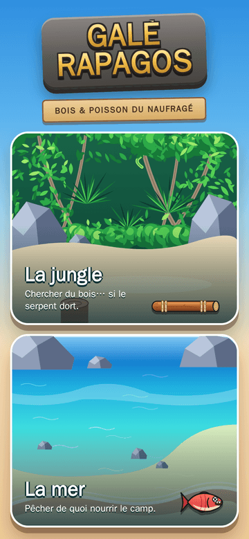
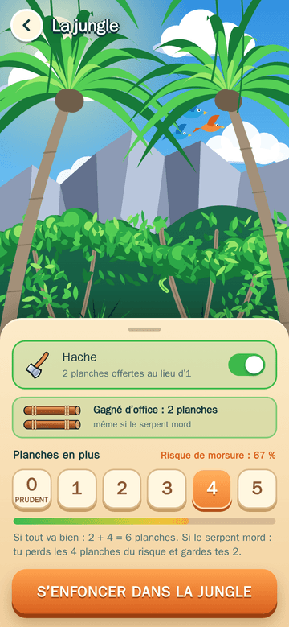
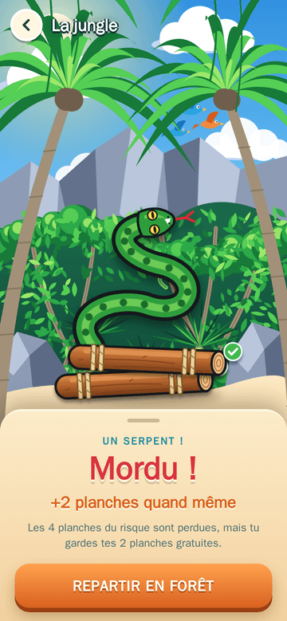
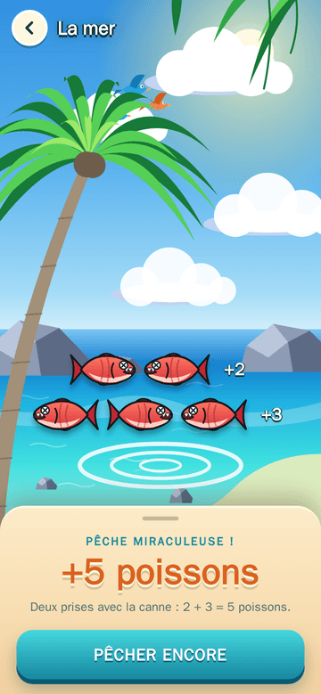

# Galèrapagos — compagnon bois & poisson

Petite appli d'aide pour le jeu de société **Galèrapagos** (Laurence et Philippe Gamelin, Gigamic).
Elle remplace la pioche de billes dans le sac : le joueur choisit son risque, l'appli tire au hasard
et montre le résultat dans le décor, **en plein jour** : la jungle pour le bois, le lagon pour la pêche.
Aucune bille n'est affichée. Pas de compte, pas de pub, pas de suivi.

| Accueil | Jungle : choisir son risque | Mordu : les planches gratuites restent | Pêche à la canne |
|---|---|---|---|
|  |  |  |  |

Deux versions, les mêmes règles et les mêmes dessins, pensées pour le smartphone en portrait :

- **Un site**, qui s'ouvre dans le navigateur, sans rien installer ;
- **Une appli Android** (Android 8 et plus).

## Comment ça marche

**Bois (jungle)**
- Une planche est **gratuite** (deux avec la **hache**) : on la garde toujours, même si le serpent mord.
- On peut tenter de **1 à 5 planches de plus**. L'appli tire ce nombre d'éléments dans un sac de 6 dont 1 serpent.
- Si le serpent sort, on est **mordu** et on perd seulement les planches tentées en plus. Le risque est de `n / 6` : 17 % pour 1 planche, 83 % pour 5.
- Zéro planche de plus, c'est zéro risque.

**Poisson (mer)**
- Un tirage dans un sac de 6 : 3 fois « 1 poisson », 2 fois « 2 poissons », 1 fois « 3 poissons ».
- Sans canne, on pêche à la **lance en bois** : une prise. Avec la **canne à pêche**, deux tirages d'un coup : le total est la somme, soit 2 à 5 poissons.

## Essayer

**Le site** : <https://kcharignon.github.io/galerapagos-help/>

**L'appli Android**, sans passer par Google Play (APK signé) :

1. Sur le téléphone, télécharger la **[dernière version](https://github.com/kcharignon/galerapagos-help/releases/download/android-latest/galerapagos.apk)**.
2. Ouvrir le fichier téléchargé. Si Android le demande, autoriser l'installation depuis le navigateur, puis toucher **Installer**
   (si Play Protect hésite : *Installer quand même*).

L'appli ne se met pas à jour toute seule : pour passer à une version plus récente, on installe la nouvelle par-dessus l'ancienne.
Toutes les versions sont sur la page des [releases](https://github.com/kcharignon/galerapagos-help/releases).

## Vie privée

L'appli ne collecte rien.

- **Aucune donnée collectée.** Pas de compte, pas de publicité, pas de statistiques d'usage, aucun outil de suivi ni service tiers.
- **Tout se passe sur l'appareil.** Le tirage est fait par le téléphone. Seuls les derniers choix (risque, hache, canne) sont mémorisés, dans l'appli
  (Android) ou dans le navigateur (site), et ils n'en sortent pas. Sur Android, si la sauvegarde automatique est activée sur le téléphone, c'est elle (et non l'appli)
  qui peut en garder une copie dans le compte Google de son propriétaire.
- **Pas d'Internet pour l'appli Android** : elle ne demande que la vibration (retour tactile). La page du site n'appelle aucune ressource externe ; elle est
  hébergée par GitHub Pages, qui voit, comme pour tout site, l'adresse IP de la visite.

Le code est public : tout cela peut se vérifier.

## Pour aller plus loin

Compiler, tester, publier, régénérer les dessins : [`docs/DEVELOPPEMENT.md`](docs/DEVELOPPEMENT.md).

## Mentions

Projet personnel, **non officiel**, sans lien avec Gigamic ni avec les auteurs du jeu. Galèrapagos est un jeu de
Laurence et Philippe Gamelin, édité par Gigamic ; il faut posséder le jeu pour y jouer. Les illustrations de ce dépôt
sont des dessins originaux inspirés de l'ambiance du jeu.
